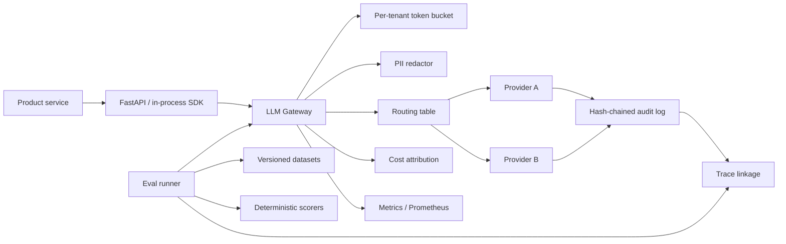

# LLM Control Plane

### A provider-agnostic LLM gateway and evaluation control plane with audit-grade traceability

[](https://github.com/itsoumya-d/llm-control-plane/actions/workflows/ci.yml)
[](https://www.python.org/)
[](https://opensource.org/licenses/MIT)
[](#testing)

Most teams add a second model provider and discover, too late, that nobody owns routing, retries, cost attribution, evaluation, or the audit trail. This project is a compact reference implementation of that missing layer: one Python package that routes model calls, fails over deterministically, enforces per-tenant rate limits, attributes cost, redacts PII, records a tamper-evident audit chain, and runs versioned evaluations with trace-level linkage.

It is built as a reviewable engineering artifact, not a hosted product. The core has **zero runtime dependencies**; FastAPI is an optional adapter.

---

## Verify-and-Repair Loop

LLM Control Plane includes an automated verify-and-repair engine (`llm_control_plane.verify_repair`) that evaluates gateway output envelopes against a structured, weighted rubric (`rubric.json`). Mechanical defects (missing default envelope fields, unformatted trace IDs, negative token usage, or negative costs) are repaired deterministically up to 3 rounds and appended to an immutable JSONL audit ledger. Semantic or non-mechanical defects (such as missing model completions or undefined providers) are reported for human triage without fabrication.

### Scoring Rubric

| Check Name | Weight | Category | Fault Type | Description |
|---|---|---|---|---|
| `required_envelope` | 20 | Presence | Mechanical | Envelope contains all required audit, tracing, and metric fields |
| `trace_id_format` | 10 | Format | Mechanical | Trace ID is non-empty and stripped of whitespace |
| `usage_metrics_non_negative` | 20 | Range | Mechanical | Prompt and completion tokens are >= 0 and total is consistent |
| `cost_and_latency_bounds` | 20 | Range | Mechanical | `cost_usd` and `latency_ms` are non-negative numeric floats |
| `content_presence` | 30 | Content | Non-mechanical | Model response text and provider identifier are non-empty |

**Passing Threshold:** 80 / 100

### Before and After Scoring Example

#### Before Repair (Score: 40/100 — Failed)
```json
{
  "text": "Generated response summary.",
  "provider": "anthropic",
  "model": "claude-3-5-sonnet",
  "trace_id": "  tr-whitespace-1234  ",
  "usage": { "prompt_tokens": -10, "completion_tokens": -5, "total_tokens": 999 },
  "cost_usd": -0.02,
  "latency_ms": -50.0
}
```
*Failures:* `trace_id_format` (-15), `usage_metrics_non_negative` (-20), `cost_and_latency_bounds` (-20), `required_envelope` (missing `audit_seq`, -25).

#### After Repair (Round 1, Score: 100/100 — Passed)
```json
{
  "text": "Generated response summary.",
  "provider": "anthropic",
  "model": "claude-3-5-sonnet",
  "trace_id": "tr-whitespace-1234",
  "usage": { "prompt_tokens": 0, "completion_tokens": 0, "total_tokens": 0 },
  "cost_usd": 0.0,
  "latency_ms": 0.0,
  "audit_seq": 0,
  "redactions": {}
}
```
*Repairs:* Trimmed `trace_id`, clamped negative usage to 0, clamped negative metrics to 0.0, defaulted missing `audit_seq` to 0. Recorded in ledger.

---

## Architecture



The gateway owns the model boundary. Product teams send a model alias, not a provider URL. The control plane owns policy, routing, retries, rate limits, redaction, cost, and evidence. The eval runner reuses the same boundary, so an evaluation run is recorded exactly like production traffic.

---

## What it does

| Capability | Implementation |
|---|---|
| **Provider routing** | Ordered fallback targets per model alias; deterministic, no hidden heuristics |
| **Failover** | Retries only retryable failures; non-retryable errors skip straight to the next target |
| **Rate limiting** | Thread-safe per-tenant token bucket with injectable clock |
| **Cost attribution** | Per-provider/model pricebook; cost recorded per request, tenant, model, and use case |
| **PII protection** | Email, phone, card, IBAN, and IPv4 redaction before provider calls and audit writes |
| **Policy guardrails** | Pre-flight model and use-case allowlists, token caps, tenant checks, trace requirements, and blocked metadata; denials are audited before any provider call |
| **Audit trail** | Append-only SHA-256 hash chain; `verify()` detects any tampered event |
| **Idempotency** | Caller-supplied `trace_id` makes retries safe and replayable |
| **Observability** | Counters, latency observations, p50/p95, and Prometheus text output |
| **Evaluations** | Versioned datasets, content hashes, four scorers, pass rate, p95 latency, cost |
| **Experiment comparison** | Baseline vs candidate run with improved/regressed/tied case lists |
| **Anthropic Applied AI Platform** | Claude prompt cache breakpoint orchestration (90% cost / 80% latency savings), zero-trust MCP tool gateway validation, and pairwise LLM-as-a-judge regression evaluation |
| **Bitpanda Elastic SecOps Platform** | Detection engineering with ES\|QL and KQL query validation, AWS CloudTrail & KMS threat hunting, automated SOAR incident response, and DORA & ISO 27001 posture tracking |
| **Inferact vLLM Cloud Orchestrator** | Distributed GPU node hardware degradation detection (XID/ECC/NVLink), automated node fencing, elastic PagedAttention KV-cache autoscaling, Ray actor placement group coordination, and zero-downtime blue/green rollouts |
| **Trace linkage** | Every eval result carries the gateway trace ID and audit head hash |

### Scorers included

- `exact_match` with whitespace/case normalization
- `contains` with optional case sensitivity
- `json_schema` with required keys, properties, arrays, and primitive type checks
- `numeric_tolerance`
- `latency_budget`

Scorers are a protocol: add your own in a few lines.

---

## Quickstart

```bash
git clone https://github.com/itsoumya-d/llm-control-plane.git
cd llm-control-plane
python3 -m venv .venv
source .venv/bin/activate
pip install -e ".[dev,api]"

pytest -q
python -m llm_control_plane.demo
python -m llm_control_plane.bench
```

### Use the gateway in-process

```python
from llm_control_plane import (
    ChatMessage,
    CompletionRequest,
    FakeProvider,
    LLMGateway,
    RoutingTable,
    provider_map,
)

primary = FakeProvider("fake-primary", responses=["approved"])
fallback = FakeProvider("fake-fallback", responses=["approved (fallback)"])
routing = RoutingTable.from_dict(
    {
        "smart": [
            {"provider": "fake-primary", "model": "fake-large"},
            {"provider": "fake-fallback", "model": "fake-small"},
        ]
    }
)
gateway = LLMGateway(provider_map(primary, fallback), routing)

result = gateway.complete(
    CompletionRequest(
        tenant_id="team-audit",
        model="smart",
        use_case="evidence-summary",
        trace_id="req-2026-10-30-001",
        messages=[ChatMessage(role="user", content="Summarize this evidence.")],
    )
)
print(result.text, result.cost_usd, result.trace_id)
print(gateway.audit.verify())
```

### Apply a pre-flight policy

```python
from llm_control_plane import PolicyEngine

policy = PolicyEngine(
    policy_id="banking-ai-v1",
    allowed_models=frozenset({"smart"}),
    allowed_use_cases=frozenset({"support", "evidence-summary"}),
    max_tokens=1024,
    require_trace_id=True,
)
gateway = LLMGateway(provider_map(primary, fallback), routing, policy=policy)
```

A denied request is rejected before the rate limiter and before any provider call. The audit chain records `request.policy_denied` with the policy ID and every failed reason; the provider never sees the prompt.

### Run the API

```bash
uvicorn llm_control_plane.api:app --reload
```

```bash
curl -s localhost:8000/v1/chat/completions \
  -H 'content-type: application/json' \
  -d '{"tenant_id":"t1","model":"smart","messages":[{"role":"user","content":"What is 2+2?"}]}'
```

Endpoints: `POST /v1/chat/completions`, `POST /v1/evals/runs`, `GET /health`, `GET /metrics`.

### Evaluate a dataset

```python
from llm_control_plane import ContainsScorer, Dataset, EvalCase, EvalRunner
from llm_control_plane.demo import build_demo_gateway

dataset = Dataset(
    name="support-answers",
    version="2026-10-30",
    cases=[
        EvalCase(id="refund", input="Can I get a refund?", expected="refund"),
        EvalCase(id="shipping", input="Where is my order?", expected="tracking"),
    ],
)
gateway = build_demo_gateway()
run = EvalRunner(gateway, [ContainsScorer()]).run(dataset, "smart", "tenant-a")
print(run.metrics())
print(run.results[0].trace_id)
```

The dataset content hash, gateway trace IDs, and audit head hash are stored on the run, so a result can be tied back to the exact evidence and model path that produced it.

---

## Benchmarks

Measured locally on an Apple Silicon Mac, Python 3.9.6, fake provider, no network. The gateway benchmark includes audit events, metrics, redaction, rate limiting, and cost attribution.

| Benchmark | Result |
|---|---|
| Gateway routing overhead, 5,000 calls | mean **0.111 ms**, p50 **0.098 ms**, p95 **0.163 ms**, p99 **0.303 ms** |
| Gateway throughput, single thread | **~9,008 calls/s** |
| Audit chain verification, 20,000 events | **178.6 ms** (~112,000 events/s) |
| Eval runner throughput, 500 cases | **~9,131 cases/s** |

Run `python -m llm_control_plane.bench` to reproduce. These numbers measure the control plane, not provider latency.

---

## Design decisions

**Deterministic failover over clever routing.** A model alias resolves to an ordered list. Retryable errors (429s, timeouts, 5xx) get bounded exponential backoff; 4xx errors do not. This makes incident behaviour predictable and testable.

**No raw prompts in the audit log.** The audit records a SHA-256 of the redacted prompt, redaction counts, provider/model, usage, cost, latency, and trace ID. Raw content stays out of the evidence store by default.

**Evidence is chained, not just logged.** Each event commits to the previous event's hash. `verify()` recomputes the entire chain; changing one payload invalidates every downstream hash.

**Idempotency is explicit.** A caller-supplied `trace_id` is a replay key. The gateway returns the original result instead of charging the tenant twice.

**Evals share the production path.** The eval runner calls the same gateway, so rate limits, redaction, failover, and audit behaviour are exercised by tests and evaluations.

**Zero core dependencies.** The core is standard library only. FastAPI, pytest, and ruff are optional extras. This keeps the control plane easy to embed and audit.

---

## Role alignment

This artifact was built to exercise the primitives described in modern **LLM Ops / AI platform** roles:

- LLM gateway with multi-provider routing, failover, rate limits, and cost attribution
- Evaluation platform with versioned datasets, run/result schemas, and trace linkage
- Observability for latency, retries, token usage, cost, and errors per tenant/use case
- Privacy controls: PII redaction, retention-friendly audit metadata, tenant isolation
- Production Python with typed boundaries, deterministic tests, and CI

It is a reference implementation, not a claim of production scale. The provider adapters are deliberately small so a real deployment can swap in Gemini, OpenAI, Anthropic, Azure OpenAI, or a self-hosted endpoint.

---

## Project structure

```
llm_control_plane/
  gateway.py       routing, failover, retries, idempotency, cost, audit
  routing.py       model aliases and ordered targets
  rate_limit.py    per-tenant token buckets
  redaction.py     deterministic PII redaction
  audit.py         append-only SHA-256 hash chain
  pricing.py       token pricebook and cost attribution
  metrics.py       counters, latency observations, Prometheus text
  evals.py         datasets, scorers, runs, experiment comparison
  openrouter.py    OpenRouter provider adapter, fallback hierarchies, and latency telemetry
  singlestore_connector.py SingleStore MCP vector connector, connection pooling, and hybrid vector search
  ray_core_executor.py Ray Core distributed cluster executor, Plasma-style object store, and actor pool
  duckdb_engine.py MotherDuck hybrid analytical execution engine, dual-execution planner, and cost profiler
  modal_sandbox.py Modal serverless container sandbox, microVM snapshotting, and cgroups v2 worker pool
  together_infra_agent.py Together AI infra agent systems: GPU fleet knowledge graph, Xid triage, and self-revalidation
  clickhouse_platform_auth.py ClickHouse Cloud platform auth: Zanzibar/ReBAC engine, SCIM 2.0, JWT, and audit telemetry
  poolside_inference_scheduler.py Poolside inference infra: distributed GPU workload scheduler, prefix KV-routing, and K8s controller
  tavily_web_access_engine.py Tavily agentic web access engine: HTTP/2 TLS fingerprinting (JA3/JA4), anti-bot challenge classification, and adaptive fetch scheduling
  resend_mta_transport.py Resend MTA transport infrastructure: multi-tier leaky bucket throttling, IP pool warmup state machines, and RFC 3463 delivery outcome classification
  seo_rank_engine.py SEO rank engine & performance analytics: automated SERP harvesting, Core Web Vitals diagnostics, semantic intent clustering, and SHA-256 audit reports
  lakehouse_analytics_engine.py Lakehouse analytics & governance engine: Medallion architecture (Bronze/Silver/Gold), SCD Type 2 dimension tracking, and declarative semantic metric layer
  pinecone_experience_telemetry.py Pinecone Experience Platform telemetry & usage-based billing engine: sub-second RU/WU calculations, idempotent metering, spend alert management, and FinOps FOCUS v1.4 export
  replit_cloud_orchestrator.py Replit Cloud infrastructure orchestrator: ephemeral container sandbox lifecycle, pre-warmed snapshot pool, dev/prod database branching with DDL safety gates, and custom domain ingress
  decagon_agent_platform.py Decagon Agent Platform runtime: hierarchical multi-model orchestration (Router/Planner/Supervisor), deterministic tool execution with idempotency hashing, and sub-15ms barge-in event handling
  airbyte_agent_infrastructure.py Airbyte Agent Infrastructure & MCP connector runtime: token-bucket connector rate limiting, semantic data modeling, stateful SaaS sandbox simulation, and cryptographic audit chaining
  supabase_ai_platform.py Supabase AI Platform execution layer: model-agnostic runtime, durable WAL state checkpointing, structural risk tiers, async human review gate, atomic rollback engine, and golden evaluation suite
  braintrust_sdk_observability.py Braintrust SDK observability & evaluation runtime: zero-overhead span tracing, context-manager/decorator APIs, async telemetry buffer with offline spooling, and pluggable evaluation scorers
  mongodb_kubernetes_operator_platform.py MongoDB Kubernetes Operator & Core Platforms: declarative CRD specification, quorum-verified controller reconciliation, split-brain fencing, Atlas Search & Vector Search sidecar orchestration, zero-downtime rolling upgrades with FCV transitions, and Prometheus SLO metrics telemetry
  onehouse_k8s_lakehouse_operator.py Onehouse Kubernetes Lakehouse Operator: declarative custom controllers, Hudi table service reconciliation loops (compaction, clustering, cleaning), dynamic worker autoscaling, spot node preemption checkpointing, and zero-downtime failover
  superchat_data_platform_orchestrator.py Superchat Data Platform Orchestrator: omnichannel messaging ELT ingestion, AWS Redshift warehouse management, dbt layered models (staging/intermediate/gold), SCD Type 2 subscription/MRR history tracking, Dagster asset graph freshness alerting, and Hightouch reverse-ETL sync audit
  flowtraders_infra_platform_orchestrator.py Flow Traders Infrastructure Platform Orchestrator: reusable Terraform module verification, OPA/policy-as-code evaluation, state drift detection, GitHub Actions CI/CD guardrails and rollback triggers, hybrid Kubernetes cluster supervision (cloud GKE and on-prem k3s), Kafka broker health and partition skew watchdogs, and Linux fleet host lifecycle supervisor
  complyadvantage_gtm_pipeline_orchestrator.py ComplyAdvantage Founding GTM Systems & Applied AI Pipeline Orchestrator: multi-source resilient market scrapers with exponential backoff & domain deduplication, Clay-style cascading enrichment waterfalls with cost-logic optimization, algorithmic defendable account scoring with regulatory enforcement weighting, event-driven signal outbound play runners, LLM account intelligence agents with PII redaction and token budgets, and idempotent CRM webhook synchronization with dead-letter queue (DLQ) support
  qualtrics_observability_engine.py Qualtrics Observability Infrastructure & Customer Experience Correlation Engine: high-throughput telemetry stream ingestion with deduplication and adaptive backpressure, Pearson/Spearman customer impact correlation (p99 latency, SLA breach tracking), automated MTTR reduction root cause analyzers with runbook dispatch, and declarative Amazon EKS Prometheus ServiceMonitor/OpenTelemetry agent automation with drift reconciliation
  engineering_productivity_engine.py Engineering Productivity & DORA Metrics Analytics Engine: DORA performance indicator computation, PR cycle time tracking, test coverage health monitoring, flaky test incident logging, and automated SDLC delivery friction scoring
  api.py           FastAPI adapter
  demo.py          deterministic end-to-end demo
  bench.py         local micro-benchmarks
tests/             539 tests covering gateway, audit, eval, API, OpenRouter, Ray Core, SingleStore, Doppler, MotherDuck, Modal sandbox, Together AI, ClickHouse auth, Poolside scheduler, Tavily engine, Resend MTA transport, SEO rank engine, Lakehouse analytics engine, Cerebras MLIR, LangGraph mesh, Fly triage, WCC automation, Railway orchestrator, Pinecone Experience telemetry, Replit Cloud orchestrator, Decagon Agent Platform runtime, Airbyte Agent Infrastructure, Supabase AI Platform, and Braintrust SDK observability engine
```

---

## Engineering Productivity & DORA Metrics Analytics

### What it does

`EngineeringProductivityAnalyzer` evaluates engineering velocity, delivery stability, and software development lifecycle (SDLC) friction across microservices:

1. **DORA Indicators**: Computes Deployment Frequency, Mean Lead Time for Changes, Change Failure Rate (CFR), and Mean Time to Restore (MTTR), scoring teams against standard DORA performance tiers (ELITE, HIGH, MEDIUM, LOW).
2. **Cycle Times & Quality Health**: Analyzes PR review turnaround latencies, CI build times, test coverage percentiles, and flaky test occurrences.
3. **Delivery Friction Scoring**: Computes a continuous friction score (0.0 to 1.0) and flags delivery bottlenecks across engineering workflows.

### Runnable Example

```python
from llm_control_plane import (
    EngineeringProductivityAnalyzer,
    DeploymentEvent,
    DeploymentStatus,
    PullRequestCycle,
)

# 1. Initialize analyzer over a rolling 30-day window
analyzer = EngineeringProductivityAnalyzer(observation_window_days=30.0)

# 2. Record deployment events
analyzer.record_deployment(
    DeploymentEvent("dep-101", "gateway-api", lead_time_minutes=25.0, status=DeploymentStatus.SUCCESS)
)
analyzer.record_deployment(
    DeploymentEvent("dep-102", "gateway-api", lead_time_minutes=45.0, status=DeploymentStatus.FAILURE, restoration_time_minutes=30.0)
)

# 3. Compute DORA metrics report
dora = analyzer.compute_dora_metrics("gateway-api")
print(f"Tier: {dora.classification.value}, CFR: {dora.change_failure_rate_percent}%, MTTR: {dora.mean_time_to_restore_minutes}m")

# 4. Evaluate pull request cycle efficiency and friction signals
analyzer.record_pr_cycle(
    PullRequestCycle("pr-55", "gateway-api", review_latency_hours=3.5, ci_duration_minutes=6.0, test_coverage_percent=88.0)
)
health = analyzer.evaluate_quality_health("gateway-api")
print(f"Friction Score: {health.friction_score}, Active Bottlenecks: {health.bottlenecks}")
```

### Limits

- Aggregates metrics from telemetry events in memory; persistence across distributed agent runs requires streaming events to persistent storage or timeseries backends.
- DORA tier thresholds use standard industry four-key benchmarks and can be calibrated per organizational maturity stage.

---

## Regulatory Jurisdiction Packs

| Jurisdiction | Code | Key Standards Enforced | Rules As Of | Status |
|---|---|---|---|---|
| **New Zealand** | `nz` | Privacy Act 2020 (IPP 5 & 11), Algorithm Charter for Aotearoa NZ, NZISM Chapter 16 | 2026-11-27 | Active |
| **India** | `in` | DPDP Act 2023 (Sec 8 & 9), CERT-In Cyber Security Directions 2022, RBI IT Governance Guidelines | 2026-11-27 | Active |

Not legal or tax advice - check the official source.

---

## Use it from an agent

To install and register the skill in Claude Code, Codex, or Cursor:
```bash
git clone https://github.com/itsoumya-d/llm-control-plane.git
pip install -e ".[dev]"
cp -r skills/llm-control-plane ~/.agents/skills/
```

First prompt to give your agent:
> "Run the `llm-control-plane` skill to verify gateway health and check the cryptographic audit chain."

---

## Testing

```bash
pytest -q
pytest --cov=llm_control_plane --cov-report=term-missing
ruff check .
```

CI runs the suite on Python 3.9, 3.11, and 3.12, plus lint, coverage, and a package build.

---

## Limitations

- Providers are fakes in tests and the demo. Real provider adapters are intentionally out of scope.
- The audit chain is tamper-evident, not tamper-proof; anchor the head hash in an external system for stronger guarantees.
- The included metrics registry is a dependency-free reference, not a replacement for OpenTelemetry.
- No persistent database; runs and audit logs are in memory unless you serialize them.
- Not affiliated with, endorsed by, or built from any company's proprietary code.

---

## How it stays current

- **What is watched**: Official upstream API specifications, model releases, and provider documentation locked in `sources.lock.json` (Anthropic model catalogs, OpenAI API specifications, Cerebras inference guidelines).
- **When it runs**: A scheduled GitHub Actions workflow (`.github/workflows/watch.yml`) executes daily at `06:00 UTC` via `scripts/watch.py` without external dependencies.
- **Human approval required**: Automated scripts never mutate business policies or route configurations directly. When an upstream content drift or hash divergence is detected, the run records unified diffs to `watch/<topic>/<YYYY-MM-DD>.json`, updates `watch/latest.json`, and opens an actionable GitHub Issue for an engineer to review and approve rule adjustments. If an upstream host is unreachable, the run captures the error gracefully and exits 0 to prevent spurious CI failures.
- **Runtime freshness checks**: At startup, `llm_control_plane.watch.check_source_freshness()` verifies that production configurations do not lag unreviewed upstream changes beyond configurable age thresholds.

---

## License

MIT © 2026 Soumya Debnath
