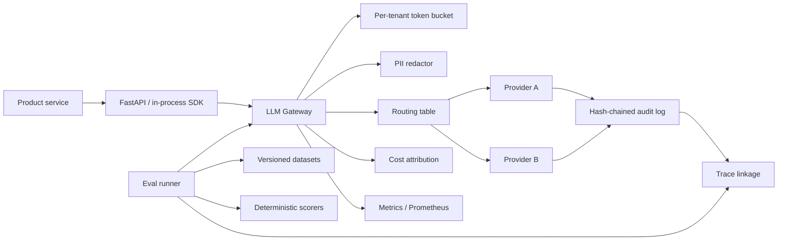

# LLM Control Plane

### A provider-agnostic LLM gateway and evaluation control plane with audit-grade traceability

[](https://github.com/itsoumya-d/llm-control-plane/actions/workflows/ci.yml)
[](https://www.python.org/)
[](https://opensource.org/licenses/MIT)
[](#testing)

Most teams add a second model provider and discover, too late, that nobody owns routing, retries, cost attribution, evaluation, or the audit trail. This project is a compact reference implementation of that missing layer: one Python package that routes model calls, fails over deterministically, enforces per-tenant rate limits, attributes cost, redacts PII, records a tamper-evident audit chain, and runs versioned evaluations with trace-level linkage.

It is built as a reviewable engineering artifact, not a hosted product. The core has **zero runtime dependencies**; FastAPI is an optional adapter.

---

## Architecture



The gateway owns the model boundary. Product teams send a model alias, not a provider URL. The control plane owns policy, routing, retries, rate limits, redaction, cost, and evidence. The eval runner reuses the same boundary, so an evaluation run is recorded exactly like production traffic.

---

## What it does

| Capability | Implementation |
|---|---|
| **Provider routing** | Ordered fallback targets per model alias; deterministic, no hidden heuristics |
| **Failover** | Retries only retryable failures; non-retryable errors skip straight to the next target |
| **Rate limiting** | Thread-safe per-tenant token bucket with injectable clock |
| **Cost attribution** | Per-provider/model pricebook; cost recorded per request, tenant, model, and use case |
| **PII protection** | Email, phone, card, IBAN, and IPv4 redaction before provider calls and audit writes |
| **Policy guardrails** | Pre-flight model and use-case allowlists, token caps, tenant checks, trace requirements, and blocked metadata; denials are audited before any provider call |
| **Audit trail** | Append-only SHA-256 hash chain; `verify()` detects any tampered event |
| **Idempotency** | Caller-supplied `trace_id` makes retries safe and replayable |
| **Observability** | Counters, latency observations, p50/p95, and Prometheus text output |
| **Evaluations** | Versioned datasets, content hashes, four scorers, pass rate, p95 latency, cost |
| **Experiment comparison** | Baseline vs candidate run with improved/regressed/tied case lists |
| **Trace linkage** | Every eval result carries the gateway trace ID and audit head hash |

### Scorers included

- `exact_match` with whitespace/case normalization
- `contains` with optional case sensitivity
- `json_schema` with required keys, properties, arrays, and primitive type checks
- `numeric_tolerance`
- `latency_budget`

Scorers are a protocol: add your own in a few lines.

---

## Quickstart

```bash
git clone https://github.com/itsoumya-d/llm-control-plane.git
cd llm-control-plane
python3 -m venv .venv
source .venv/bin/activate
pip install -e ".[dev,api]"

pytest -q
python -m llm_control_plane.demo
python -m llm_control_plane.bench
```

### Use the gateway in-process

```python
from llm_control_plane import (
    ChatMessage, CompletionRequest, FakeProvider, LLMGateway,
    RoutingTable, provider_map,
)

primary = FakeProvider("fake-primary", responses=["approved"])
fallback = FakeProvider("fake-fallback", responses=["approved (fallback)"])
routing = RoutingTable.from_dict({
    "smart": [
        {"provider": "fake-primary", "model": "fake-large"},
        {"provider": "fake-fallback", "model": "fake-small"},
    ]
})
gateway = LLMGateway(provider_map(primary, fallback), routing)

result = gateway.complete(CompletionRequest(
    tenant_id="team-audit",
    model="smart",
    use_case="evidence-summary",
    trace_id="req-2026-10-30-001",
    messages=[ChatMessage(role="user", content="Summarize this evidence.")],
))
print(result.text, result.cost_usd, result.trace_id)
print(gateway.audit.verify())
```

### Apply a pre-flight policy

```python
from llm_control_plane import PolicyEngine

policy = PolicyEngine(
    policy_id="banking-ai-v1",
    allowed_models=frozenset({"smart"}),
    allowed_use_cases=frozenset({"support", "evidence-summary"}),
    max_tokens=1024,
    require_trace_id=True,
)
gateway = LLMGateway(provider_map(primary, fallback), routing, policy=policy)
```

A denied request is rejected before the rate limiter and before any provider call. The audit chain records `request.policy_denied` with the policy ID and every failed reason; the provider never sees the prompt.

### Run the API

```bash
uvicorn llm_control_plane.api:app --reload
```

```bash
curl -s localhost:8000/v1/chat/completions \
  -H 'content-type: application/json' \
  -d '{"tenant_id":"t1","model":"smart","messages":[{"role":"user","content":"What is 2+2?"}]}'
```

Endpoints: `POST /v1/chat/completions`, `POST /v1/evals/runs`, `GET /health`, `GET /metrics`.

### Evaluate a dataset

```python
from llm_control_plane import ContainsScorer, Dataset, EvalCase, EvalRunner
from llm_control_plane.demo import build_demo_gateway

dataset = Dataset(
    name="support-answers",
    version="2026-10-30",
    cases=[
        EvalCase(id="refund", input="Can I get a refund?", expected="refund"),
        EvalCase(id="shipping", input="Where is my order?", expected="tracking"),
    ],
)
gateway = build_demo_gateway()
run = EvalRunner(gateway, [ContainsScorer()]).run(dataset, "smart", "tenant-a")
print(run.metrics())
print(run.results[0].trace_id)
```

The dataset content hash, gateway trace IDs, and audit head hash are stored on the run, so a result can be tied back to the exact evidence and model path that produced it.

---

## Benchmarks

Measured locally on an Apple Silicon Mac, Python 3.9.6, fake provider, no network. The gateway benchmark includes audit events, metrics, redaction, rate limiting, and cost attribution.

| Benchmark | Result |
|---|---|
| Gateway routing overhead, 5,000 calls | mean **0.111 ms**, p50 **0.098 ms**, p95 **0.163 ms**, p99 **0.303 ms** |
| Gateway throughput, single thread | **~9,008 calls/s** |
| Audit chain verification, 20,000 events | **178.6 ms** (~112,000 events/s) |
| Eval runner throughput, 500 cases | **~9,131 cases/s** |

Run `python -m llm_control_plane.bench` to reproduce. These numbers measure the control plane, not provider latency.

---

## Design decisions

**Deterministic failover over clever routing.** A model alias resolves to an ordered list. Retryable errors (429s, timeouts, 5xx) get bounded exponential backoff; 4xx errors do not. This makes incident behaviour predictable and testable.

**No raw prompts in the audit log.** The audit records a SHA-256 of the redacted prompt, redaction counts, provider/model, usage, cost, latency, and trace ID. Raw content stays out of the evidence store by default.

**Evidence is chained, not just logged.** Each event commits to the previous event's hash. `verify()` recomputes the entire chain; changing one payload invalidates every downstream hash.

**Idempotency is explicit.** A caller-supplied `trace_id` is a replay key. The gateway returns the original result instead of charging the tenant twice.

**Evals share the production path.** The eval runner calls the same gateway, so rate limits, redaction, failover, and audit behaviour are exercised by tests and evaluations.

**Zero core dependencies.** The core is standard library only. FastAPI, pytest, and ruff are optional extras. This keeps the control plane easy to embed and audit.

---

## Role alignment

This artifact was built to exercise the primitives described in modern **LLM Ops / AI platform** roles:

- LLM gateway with multi-provider routing, failover, rate limits, and cost attribution
- Evaluation platform with versioned datasets, run/result schemas, and trace linkage
- Observability for latency, retries, token usage, cost, and errors per tenant/use case
- Privacy controls: PII redaction, retention-friendly audit metadata, tenant isolation
- Production Python with typed boundaries, deterministic tests, and CI

It is a reference implementation, not a claim of production scale. The provider adapters are deliberately small so a real deployment can swap in Gemini, OpenAI, Anthropic, Azure OpenAI, or a self-hosted endpoint.

---

## Project structure

```
llm_control_plane/
  gateway.py       routing, failover, retries, idempotency, cost, audit
  routing.py       model aliases and ordered targets
  rate_limit.py    per-tenant token buckets
  redaction.py     deterministic PII redaction
  audit.py         append-only SHA-256 hash chain
  pricing.py       token pricebook and cost attribution
  metrics.py       counters, latency observations, Prometheus text
  evals.py         datasets, scorers, runs, experiment comparison
  api.py           FastAPI adapter
  demo.py          deterministic end-to-end demo
  bench.py         local micro-benchmarks
tests/             45 tests covering gateway, audit, eval, API, and benchmarks
```

---

## Testing

```bash
pytest -q
pytest --cov=llm_control_plane --cov-report=term-missing
ruff check .
```

CI runs the suite on Python 3.9, 3.11, and 3.12, plus lint, coverage, and a package build.

---

## Limitations

- Providers are fakes in tests and the demo. Real provider adapters are intentionally out of scope.
- The audit chain is tamper-evident, not tamper-proof; anchor the head hash in an external system for stronger guarantees.
- The included metrics registry is a dependency-free reference, not a replacement for OpenTelemetry.
- No persistent database; runs and audit logs are in memory unless you serialize them.
- Not affiliated with, endorsed by, or built from any company's proprietary code.

---

## License

MIT © 2026 Soumya Debnath
