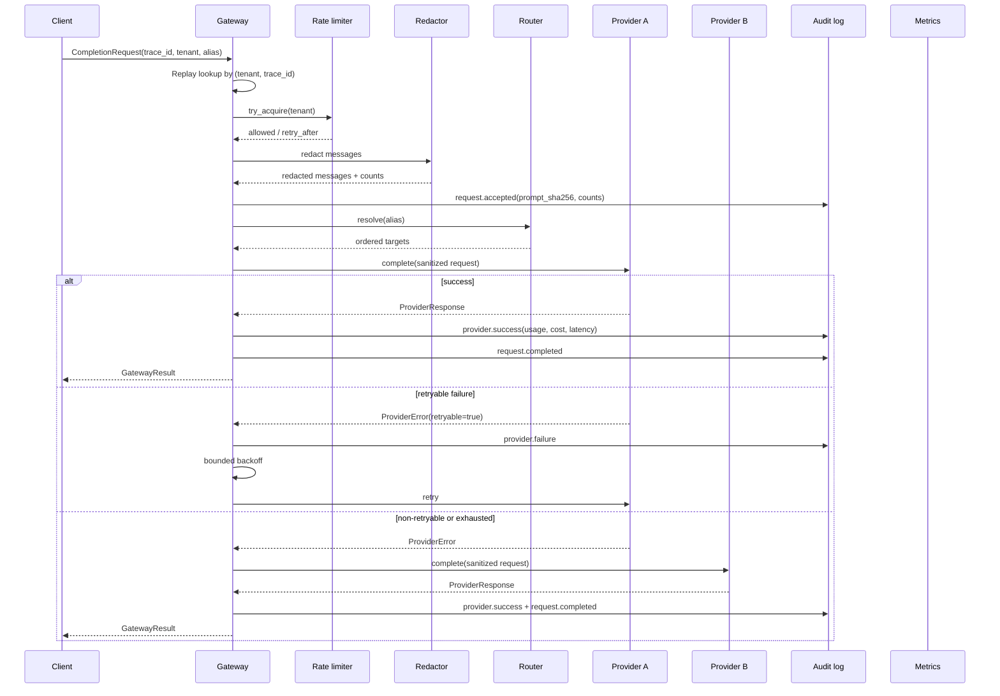

# Architecture

## Goal

Provide one owned boundary between product services and model providers. The boundary must make routing, failure behaviour, cost, privacy, and evidence inspectable without requiring a hosted platform.

## Request lifecycle

## Failure model

| Condition | Behaviour |
|---|---|
| 429, timeout, 5xx, provider unhealthy | Retry up to `max_attempts_per_target` with exponential backoff, then fail over |
| 4xx other than 429, invalid request | No retry; fail over to the next configured target |
| Unknown model alias | Fail immediately; audit `request.failed` |
| Provider not registered | Audit `provider.missing`; continue to next target |
| All targets exhausted | Raise `ProviderError`; audit the complete error list |
| Tenant bucket empty | Raise `RateLimitExceeded` with `retry_after_seconds`; no provider call |

The retry policy is intentionally small and explicit. There is no hidden circuit breaker or adaptive routing in this reference implementation; those are natural extension points.

## Idempotency

A caller-supplied `trace_id` is scoped to `(tenant_id, trace_id)`. Replaying the same key returns the original `GatewayResult` and increments `gateway_idempotent_replays_total`. This makes client retries and queue redelivery safe without double-charging a tenant.

## Audit chain

Each event contains:

- monotonic `seq`
- timestamp
- event type
- structured payload
- `prev_hash`
- `hash = SHA-256(canonical_json(event without hash))`

`verify()` walks the chain from the genesis hash and validates both the linkage and each event hash. A single changed byte in any payload invalidates every later event.

The chain is **tamper-evident**, not tamper-proof. For stronger guarantees, periodically anchor `head_hash()` in an external append-only system or a transparency log.

## Privacy boundary

- PII is redacted before the provider call and before audit persistence.
- Audit payloads include a SHA-256 of the redacted prompt, not the prompt itself.
- Redaction types are counted for observability without storing the matched values.
- Tenant IDs are included in cost and request metrics, but not in provider payloads.

## Observability

`MetricsRegistry` exposes counters and latency observations. The Prometheus adapter emits:

- `gateway_requests_total`
- `gateway_rate_limited_total`
- `gateway_failures_total`
- `gateway_idempotent_replays_total`
- `provider_attempts_total`
- `provider_success_total`
- `provider_failures_total`
- `provider_latency_ms_{count,sum,p50,p95}`
- `provider_tokens_total`
- `provider_cost_usd_total`
- `tenant_cost_usd_total`

For a real deployment, replace this registry with OpenTelemetry instruments and export to the platform's existing collector.

## Extension points

| Need | Extension |
|---|---|
| Real providers | Implement `LLMProvider` with the same `complete`/`health` contract |
| Durable workflows | Wrap `complete` in Temporal activities; use `trace_id` as the idempotency key |
| Persistent evals | Store `EvalRun.to_dict()` in Postgres or object storage; index by dataset hash and model alias |
| Policy routing | Add a policy layer before `RoutingTable.resolve` (tenant tier, data residency, budget) |
| Stronger audit | Anchor `head_hash()` externally and sign batches |
| Real metrics | Swap `MetricsRegistry` for OpenTelemetry counters/histograms |

## Threat model

| Threat | Control |
|---|---|
| Prompt injection leaking secrets to a provider | Redaction before provider call; caller-side allowlists are still required |
| Cost runaway from one tenant | Per-tenant token bucket; per-tenant cost metrics |
| Silent provider degradation | Explicit failover order, retries, and provider health map |
| Audit log tampering | SHA-256 hash chain and `verify()` |
| Double charging on retry | `(tenant, trace_id)` replay cache |
| Cross-tenant data exposure | Tenant-scoped keys, cost labels, and no shared provider payload state |

## Non-goals

- Hosted multi-region deployment
- Billing or invoice generation
- Model fine-tuning
- Prompt management UI
- Replacing a full observability stack

## Benchmarks

`python -m llm_control_plane.bench` measures the control plane with a fake provider. It includes audit writes, metrics, redaction, rate limiting, and cost attribution. It excludes network latency and provider inference time.
